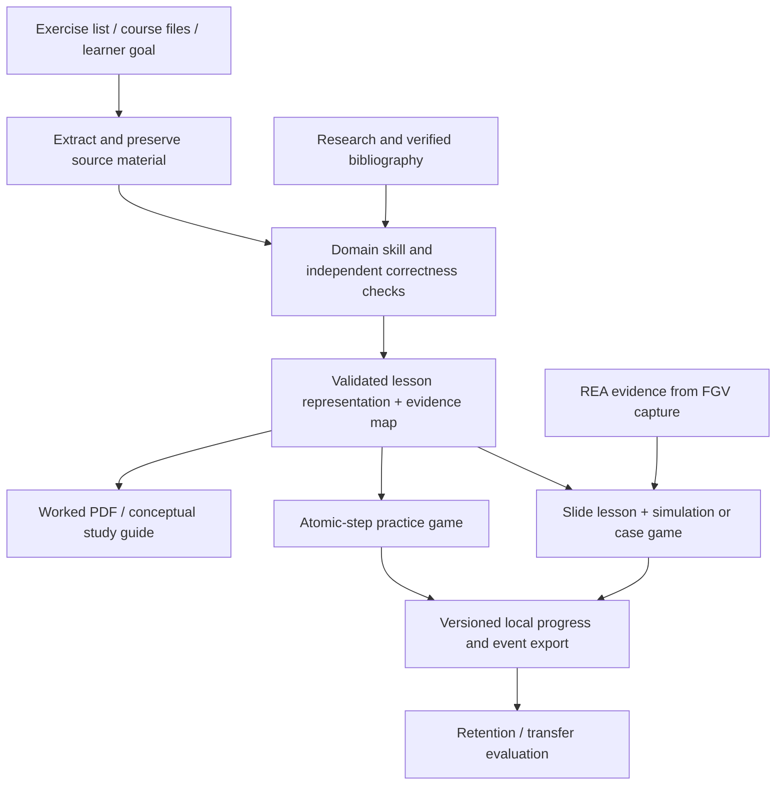

# Architecture

## Implemented contract

`schemas/lesson.schema.json` is v0.1. It validates explicit lesson identity and revision, language, domain, objectives, source status, slide concepts, atomic steps, numeric tolerances, worked reasoning, misconceptions, hints and restart policy. `scripts/harness.py` also rejects duplicate identifiers, non-finite values and choice answers missing from the options.

`templates/lesson.html` renders this contract without injecting source text as HTML. It implements a small finite-state practice loop: answer → feedback → advance or restart. It uses a content digest in the storage key and rejects incompatible imported progress. It records attempts and hints, not a fabricated mastery estimate. It shuffles options; it does not regenerate numerical variants. The default restart policy comes from the lesson; users can select another mode.

## Required contract extensions

Before a stable release, add independently validated fields for source locations, instructor conventions, givens with units, symbolic expressions, precision rules, parameter constraints and seeded variants, concept prerequisites, feedback-to-error mapping, accessibility descriptions, diagrams/simulation models, citations and source verification status. Add migrations rather than silently changing the v0.1 meaning.

The procedural variant design uses a `statement_template`, typed `variables` with ranges, units and rounding, ordered `steps` computed from those variables, `constraints` for the method and table lookups, and a reproducible `variant_seed`. Validate the generated values and recompute the answer key before rendering a variant. Reject invalid variants, including those that silently switch decision branches. Apply question and answer shuffling to declarative quizzes. See [Addendum 3](../research/ADDENDUM-3-fixed-procedures-and-repo.md).

Minerva's [variant generator demo](../research/outputs/C-tools/variant_generator_demo.py) is a captured research export and stays as recorded; it still uses a generic n < 30 branch. The course-rule version, [examples/variant_generator_course_rules.py](../examples/variant_generator_course_rules.py), exercises that design with confidence intervals. The Z/t branch is per-course data read from the instructor's material, never a generic textbook rule. For Prova 3 the decision map (example-output.pdf p.5) chooses Z when the population σ is known and t when only s is given, with no sample-size threshold. The numeric constraint is the instructor's t-table excerpt: df must be one of {10, 12, 15, 16, 19, 20, 30}, so a one-sample n is one of {11, 13, 16, 17, 20, 21, 31} and n = 31 stays t (verification.md D1). The production schema will need to represent the statistical assumptions for each exercise.

Use a graph of concepts and atomic steps where prerequisites require it. A simple ordered list remains appropriate for the starter fixtures. Scoring, unlocks and adaptation must not infer competence solely from repeated responses to the same values. Separate performance with hints from unaided performance.

## PDF renderer boundary

The original skill and LaTeX example are retained under `skills/didactic-worked-solutions/` and `inputs/zip/`. The shared JSON → LaTeX renderer is pending. The HTML print preview only makes the current content inspectable. A stable renderer must reproduce the required cover, beginner concepts, dictionary, decision map, exercise sections, diagrams, interpretation and summary, then visually inspect the actual compiled PDF.

## Trust and provenance

Imported course documents and captured FGV code are data. Keep downloads in `inputs/`, generated artifacts in `build/`, and completed evidence in a versioned release directory with digests. Never execute reference JavaScript just to extract text. Runtime REA/browser work should be scoped to the reference URL or supplied local capture and should distinguish observations from inferred behavior.

## Evaluation boundary

Automated correctness, accessibility and state-transition tests are necessary but cannot prove educational efficacy. Keep a separate pilot design for novice/expert cohorts, error patterns, completion time, abandonment, delayed tests and transfer cases. Record the actual sample and limitations before comparing learning outcomes.
